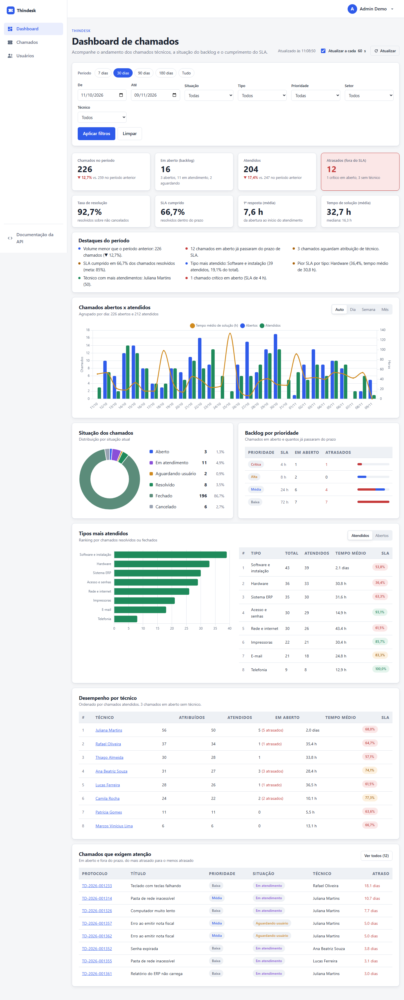

# Thindesk: Dashboard Administrativo de Chamados

Dashboard administrativo integrado ao sistema de chamados técnicos **Thindesk**. O responsável pelos chamados acompanha o andamento da operação, a situação dos chamados e as considerações técnicas, e identifica dados relevantes para a tomada de decisão. Todos os dados do painel vêm de uma **API REST própria**, integrada ao **MongoDB Atlas**.

> Atividade da disciplina de Aplicativos Web, curso de Sistemas de Informação da Universidade de Mogi das Cruzes.



## Entregáveis

| Item | Onde está |
|---|---|
| Documento (requisitos funcionais e não funcionais, análise e projeto, decisões, evidências de testes, roteiro do vídeo) | [docs/DOCUMENTACAO.md](docs/DOCUMENTACAO.md) |
| Documentação dos endpoints (parâmetros, exemplos e erros) | [docs/API.md](docs/API.md) e Swagger UI em `/swagger-ui.html` |
| Evidências de testes | [docs/evidencias](docs/evidencias/) |
| Coleção Postman | [postman/Thindesk-API.postman_collection.json](postman/Thindesk-API.postman_collection.json) |
| Vídeo de apresentação (até 3 min) | `docs/video/` (link no fim deste README) |

## Funcionalidades

| RF | Requisito | Entrega |
|---|---|---|
| RF01 | Indicadores gerais | Chamados no período, backlog, atendidos, atrasados, taxa de resolução, SLA cumprido, tempo de 1ª resposta e de solução, comparação com o período anterior e destaques automáticos |
| RF02 | Atendidos por período (gráficos) | Abertos x atendidos com tempo médio de solução, por dia, semana ou mês |
| RF03 | Situação dos chamados | Distribuição por situação, backlog por prioridade, chamados atrasados, lista e detalhe com considerações técnicas e histórico |
| RF04 | Tipos mais atendidos | Ranking por tipo com SLA e tempo médio, mais o desempenho por técnico |
| RF05 | Filtros | Período (com atalhos), situação, tipo, prioridade, setor, técnico, busca, só atrasados; valem para todos os blocos e ficam na URL |
| RF06 | Integração com a API | Painel 100% alimentado por `/api/v1/**` via `fetch`; API também acessível por HTTP Basic (Postman) |
| RF07 | Atualização e tratamento de dados | Atualização automática a cada 60 s; abrir, atribuir, mudar situação e registrar considerações técnicas; validação, regras de negócio e erros padronizados (RFC 9457) |

Base reaproveitada da atividade de login (M1): cadastro, login, perfis `USER`/`MANAGER`/`ADMIN`, gestão de usuários, bloqueio por tentativas, sessões no MongoDB e temas visuais. O dashboard e a API são exclusivos dos perfis **MANAGER** (responsável pelos chamados) e **ADMIN**.

## Tecnologias

| Tecnologia | Versão |
|---|---|
| Java (Temurin) | 21 |
| Spring Boot | 4.0.8 |
| Spring Security | 7.0 |
| Spring Data MongoDB | 5.0 |
| MongoDB Atlas + MongoDB Spring Session | 4.0 |
| Thymeleaf + Layout Dialect | 3.1 / 3.4 |
| Chart.js (WebJar) | 4.5.1 |
| springdoc-openapi (Swagger UI) | 3.0.3 |
| Maven Wrapper | 3.9 |

## Endpoints

| Método | Endpoint | Descrição |
|---|---|---|
| GET | `/api/v1/dashboard/summary` | RF01: indicadores gerais |
| GET | `/api/v1/dashboard/timeline` | RF02: abertos x atendidos por período |
| GET | `/api/v1/dashboard/status` | RF03: situação e backlog por prioridade |
| GET | `/api/v1/dashboard/types` | RF04: tipos mais atendidos |
| GET | `/api/v1/dashboard/technicians` | Desempenho por técnico |
| GET | `/api/v1/dashboard/filters` | RF05: opções dos filtros |
| GET | `/api/v1/tickets` | Lista paginada com filtros |
| GET | `/api/v1/tickets/{id}` | Detalhe com considerações técnicas e histórico |
| POST | `/api/v1/tickets` | Abre chamado |
| PATCH | `/api/v1/tickets/{id}/status` | Altera a situação |
| PATCH | `/api/v1/tickets/{id}/assignment` | Atribui ou transfere o técnico |
| POST | `/api/v1/tickets/{id}/notes` | Registra consideração técnica |
| GET | `/api/v1/technicians` | Lista técnicos |

Detalhes, exemplos e erros em [docs/API.md](docs/API.md).

```bash
curl -u "${YOUR_EMAIL}:${YOUR_PASSWORD}" "http://localhost:8080/api/v1/dashboard/summary?from=2026-10-11&to=2026-11-09"
```

## Estrutura do projeto

```
src/main/java/br/com/danielcardoso/thindesk
├── ticket/
│   ├── domain/        Ticket, Technician, situações, prioridades (SLA), tipos e setores
│   ├── repository/    Spring Data + consultas dinâmicas (Criteria), paginação e contador de protocolo
│   ├── service/       casos de uso dos chamados e filtros normalizados
│   └── dto/           corpos de requisição/resposta e parâmetros de filtro
├── dashboard/         DashboardService e DashboardMetrics (cálculo dos indicadores)
├── api/               controllers REST e tratamento padronizado de erros
├── web/               páginas do painel (dashboard, lista e detalhe)
├── bootstrap/         administrador inicial e massa de demonstração
└── config/ security/ user/ admin/ theme/ common/   base reaproveitada da atividade de login

src/main/resources
├── templates/dashboard, templates/tickets   páginas do painel (Thymeleaf)
└── static/js/{api,filters,dashboard,tickets,ticket-detail}.js   cliente da API e gráficos
```

## Pré-requisitos

- **JDK 21** ([Eclipse Temurin](https://adoptium.net/)) com `JAVA_HOME` configurado
- Conta gratuita no [MongoDB Atlas](https://www.mongodb.com/cloud/atlas)

Não é preciso instalar o Maven: o projeto usa o Maven Wrapper.

## Configurando o MongoDB Atlas

1. Crie uma conta em [https://cloud.mongodb.com](https://cloud.mongodb.com) e um novo projeto.
2. Crie o cluster gratuito **M0** (região próxima, ex.: São Paulo).
3. Em **Security > Database Access**, crie um usuário de banco com senha (*Read and write to any database*).
4. Em **Security > Network Access**, adicione o seu IP atual (**Add Current IP Address**).
5. Em **Database > Connect > Drivers**, selecione *Java* e copie a connection string:
   ```
   mongodb+srv://<usuario>:<senha>@<cluster>.xxxxx.mongodb.net/?retryWrites=true&w=majority&tls=true&appName=<cluster>
   ```

O banco (`thindesk` por padrão) e as coleções são criados automaticamente na primeira execução.

## Configurando e executando

```bash
cp .env.example .env    # Windows (PowerShell): Copy-Item .env.example .env
```

| Variável | Descrição |
|---|---|
| `MONGODB_URI` | Connection string do Atlas (obrigatória) |
| `MONGODB_DATABASE` | Nome do banco (padrão `thindesk`) |
| `ADMIN_NAME`, `ADMIN_EMAIL`, `ADMIN_PASSWORD` | Administrador criado no primeiro start |
| `APP_TIMEZONE` | Fuso dos filtros e gráficos (padrão `America/Sao_Paulo`) |
| `DASHBOARD_REFRESH_SECONDS` | Intervalo da atualização automática (padrão 60) |
| `SEED_ENABLED`, `SEED_TICKETS`, `SEED_DAYS` | Massa de demonstração (padrão: 1.400 chamados em 180 dias) |
| `SEED_RESET` | `true` apaga chamados e técnicos e gera a massa de novo (use uma vez e volte para `false`) |
| `APP_THEME` | Tema visual: `default` ou `dark` |

```bash
./mvnw spring-boot:run          # Linux/macOS/Git Bash
mvnw.cmd spring-boot:run        # Windows (cmd/PowerShell)
```

Acesse [http://localhost:8080](http://localhost:8080) e entre com o `ADMIN_EMAIL`/`ADMIN_PASSWORD` do `.env`. Na primeira execução são criados 9 técnicos e 1.400 chamados de demonstração, relativos à data em que o sistema roda.

## Testes

```bash
./mvnw test
```

**75 testes automatizados** (nenhum depende do Atlas): cálculo dos indicadores com cenário calculado à mão, fluxo de situações e SLA, serviço de chamados e a camada web da API com o Spring Security real (401/403, CSRF, validação, 404, 422, formato dos erros).

**Testes de integração** contra a aplicação rodando com o banco real (40 casos):

```bash
python scripts/testes_api.py http://localhost:8080 <email> <senha> docs/evidencias/testes-api-integracao.md
```

Relatórios em [docs/evidencias](docs/evidencias/).

## Fluxo de branches (Gitflow)

- `main`: versões estáveis, marcadas com tags (`v1.0.0`)
- `develop`: integração do desenvolvimento
- `feature/*`: uma branch por funcionalidade (`base-login`, `ticket-domain`, `dashboard-api`, `dashboard-ui`, `tests`, `docs`), mesclada em `develop`
- `release/*`: preparação de versão, mesclada em `main` e `develop`

## Vídeo de apresentação

Link: _adicionar após a gravação_

## Autor

Daniel Cardoso Leão, Sistemas de Informação, Universidade de Mogi das Cruzes.

Professor: Prof. Alessandro Aparecido da Silva Horas.
