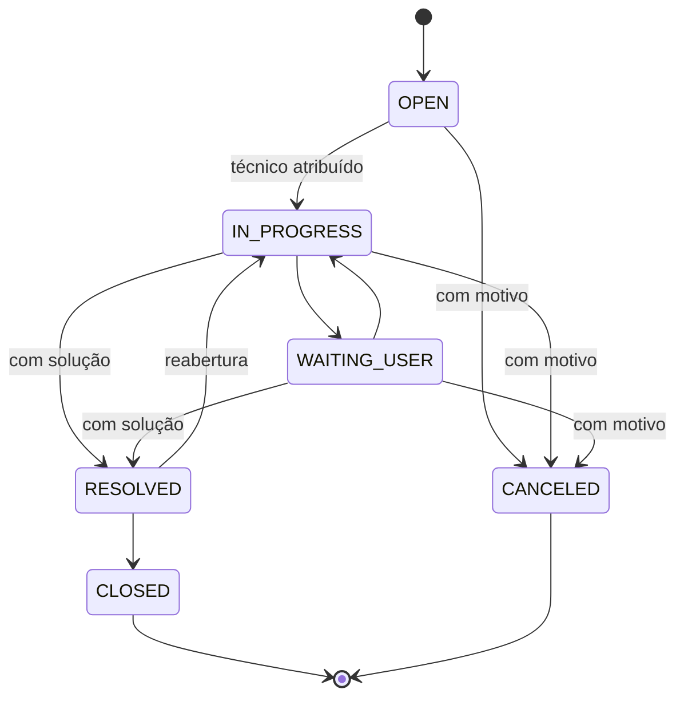

# Documentação da API REST

API do painel administrativo do sistema de chamados **Thindesk**. Alimenta todos os indicadores, gráficos, rankings e filtros do dashboard (RF06) e permite atualizar os chamados (RF07).

- **URL base:** `http://localhost:8080/api/v1`
- **Formato:** JSON (UTF-8). Corpos de requisição com `Content-Type: application/json`.
- **Documentação interativa:** [http://localhost:8080/swagger-ui.html](http://localhost:8080/swagger-ui.html) (OpenAPI 3 em [/v3/api-docs](http://localhost:8080/v3/api-docs))
- **Coleção Postman:** [`postman/Thindesk-API.postman_collection.json`](../postman/Thindesk-API.postman_collection.json)
- **Respostas reais de exemplo:** pasta [`docs/evidencias`](evidencias/)

## Sumário

| Método | Endpoint | Descrição | RF |
|---|---|---|---|
| GET | [`/dashboard/summary`](#get-dashboardsummary) | Indicadores gerais | RF01 |
| GET | [`/dashboard/timeline`](#get-dashboardtimeline) | Abertos x atendidos por período | RF02 |
| GET | [`/dashboard/status`](#get-dashboardstatus) | Situação dos chamados e backlog por prioridade | RF03 |
| GET | [`/dashboard/types`](#get-dashboardtypes) | Tipos de chamados mais atendidos | RF04 |
| GET | [`/dashboard/technicians`](#get-dashboardtechnicians) | Desempenho por técnico | RF01/RF04 |
| GET | [`/dashboard/filters`](#get-dashboardfilters) | Opções dos filtros | RF05 |
| GET | [`/tickets`](#get-tickets) | Lista paginada de chamados | RF03/RF05 |
| GET | [`/tickets/{id}`](#get-ticketsid) | Detalhe do chamado | RF03 |
| POST | [`/tickets`](#post-tickets) | Abre um chamado | RF07 |
| PATCH | [`/tickets/{id}/status`](#patch-ticketsidstatus) | Altera a situação | RF07 |
| PATCH | [`/tickets/{id}/assignment`](#patch-ticketsidassignment) | Atribui ou transfere o técnico | RF07 |
| POST | [`/tickets/{id}/notes`](#post-ticketsidnotes) | Registra consideração técnica | RF07 |
| GET | [`/technicians`](#get-technicians) | Lista os técnicos | RF05 |

## Autenticação e autorização

Todos os endpoints exigem um usuário com perfil **MANAGER** (responsável pelos chamados) ou **ADMIN**. Há duas formas de autenticar:

| Forma | Quando usar | CSRF |
|---|---|---|
| **Sessão** (cookie `SESSION`) | O próprio dashboard, depois do login em `/login` | Obrigatório em POST/PATCH: cabeçalho `X-CSRF-TOKEN` com o token publicado na página (`<meta name="_csrf">`) |
| **HTTP Basic** (`Authorization: Basic base64(email:senha)`) | Postman, curl, integrações | Dispensado: o navegador não envia esse cabeçalho sozinho para outro site, então não há risco de CSRF |

```bash
curl -u gestor@exemplo.com:SuaSenha "http://localhost:8080/api/v1/dashboard/summary?from=2026-10-11&to=2026-11-09"
```

Sem credenciais a API responde **401** em JSON (sem redirecionar para a tela de login e sem o cabeçalho `WWW-Authenticate`, para o navegador não abrir a janela nativa de senha). Perfil sem permissão recebe **403**.

## Convenções

### Filtros comuns (RF05)

Aceitos por todos os endpoints `/dashboard/*` (exceto `/filters`) e por `GET /tickets`. Todos são opcionais e combináveis (E lógico entre filtros, OU entre valores do mesmo filtro).

| Parâmetro | Tipo | Exemplo | Descrição |
|---|---|---|---|
| `from` | data `yyyy-MM-dd` | `2026-10-11` | Data inicial de **abertura** (inclusiva) |
| `to` | data `yyyy-MM-dd` | `2026-11-09` | Data final de **abertura** (inclusiva) |
| `status` | lista de enum | `OPEN,IN_PROGRESS` | `OPEN`, `IN_PROGRESS`, `WAITING_USER`, `RESOLVED`, `CLOSED`, `CANCELED` |
| `type` | lista de enum | `HARDWARE` | `HARDWARE`, `SOFTWARE`, `NETWORK`, `ACCESS`, `EMAIL`, `PRINTER`, `ERP`, `PHONE` |
| `priority` | lista de enum | `HIGH,CRITICAL` | `LOW` (SLA 72 h), `MEDIUM` (24 h), `HIGH` (8 h), `CRITICAL` (4 h) |
| `department` | lista de enum | `FINANCE` | `FINANCE`, `HR`, `SALES`, `OPERATIONS`, `MARKETING`, `LOGISTICS`, `LEGAL`, `BOARD` |
| `technicianId` | texto | `6af1d145...` | Id do técnico ou `none` para chamados sem técnico |
| `q` | texto (até 80) | `impressora` | Busca em protocolo, título, solicitante e técnico (sem diferenciar maiúsculas) |
| `overdue` | booleano | `true` | Só chamados em aberto com prazo de SLA vencido |

- Listas aceitam valores separados por vírgula (`status=OPEN,IN_PROGRESS`) ou o parâmetro repetido (`status=OPEN&status=IN_PROGRESS`).
- As datas são interpretadas no fuso **America/Sao_Paulo** (configurável em `APP_TIMEZONE`). Um chamado aberto às 22h30 de 09/11 em São Paulo (01h30 UTC do dia 10) conta no dia 09.
- Regras de validação: `from` deve ser menor ou igual a `to`, e o período pode ter no máximo 731 dias.

### Datas, números e enums nas respostas

- Instantes em ISO-8601 UTC (`2026-11-09T14:00:30Z`); datas sem horário como `yyyy-MM-dd`.
- Tempos em **horas** com uma casa decimal (`avgResolutionHours: 32.7`); percentuais de 0 a 100 com uma casa.
- Médias e percentuais vêm **`null`** quando não há dados para calcular (em vez de 0, que seria enganoso).
- Enums vêm como objeto `{ "code": "IN_PROGRESS", "label": "Em atendimento" }`, para o front não precisar traduzir.

### Definições usadas nos indicadores

| Termo | Definição |
|---|---|
| Em aberto (backlog) | Situação `OPEN`, `IN_PROGRESS` ou `WAITING_USER` |
| Atendido | Situação `RESOLVED` ou `CLOSED` (tem solução registrada) |
| Prazo (SLA) | Data de abertura + horas de SLA da prioridade |
| Atrasado | Em aberto com o prazo vencido |
| SLA cumprido | Atendidos com data de solução até o prazo, sobre o total de atendidos |
| Taxa de resolução | Atendidos sobre o total não cancelado |
| 1ª resposta | Tempo entre a abertura e o início do atendimento |
| Tempo de solução | Tempo entre a abertura e a solução |

## Erros

Todos os erros seguem o padrão **Problem Details (RFC 9457)**, com `Content-Type: application/problem+json`, sempre com `code` e `timestamp`. Erros de validação trazem também a lista `errors` campo a campo.

```json
{
  "type": "/docs/errors#validation-error",
  "title": "Parâmetros inválidos",
  "status": 400,
  "detail": "Valor inválido 'ABERTO'. Valores aceitos: OPEN, IN_PROGRESS, WAITING_USER, RESOLVED, CLOSED, CANCELED",
  "instance": "/api/v1/dashboard/summary",
  "code": "VALIDATION_ERROR",
  "timestamp": "2026-11-09T14:00:06.493Z",
  "errors": [
    { "field": "status", "message": "Valor inválido 'ABERTO'. Valores aceitos: OPEN, IN_PROGRESS, WAITING_USER, RESOLVED, CLOSED, CANCELED" }
  ]
}
```

| HTTP | `code` | Quando acontece |
|---|---|---|
| 400 | `VALIDATION_ERROR` | Parâmetro ou campo inválido: data fora do formato, enum inexistente, `from` depois de `to`, `limit`/`size` fora do intervalo, ordenação não permitida, campos obrigatórios ausentes |
| 400 | `MALFORMED_BODY` | JSON malformado ou com valor de enum inválido no corpo |
| 401 | `UNAUTHORIZED` | Sem sessão e sem credenciais, ou credenciais erradas |
| 403 | `FORBIDDEN` | Usuário sem perfil MANAGER/ADMIN |
| 403 | `CSRF_TOKEN_INVALID` | POST/PATCH com sessão sem o cabeçalho `X-CSRF-TOKEN` |
| 404 | `NOT_FOUND` | Chamado inexistente ou rota que não existe |
| 405 | `METHOD_NOT_ALLOWED` | Método HTTP não aceito no endpoint (ex.: `DELETE /tickets/{id}`) |
| 409 | `CONCURRENT_UPDATE` | O chamado foi alterado por outra pessoa entre a leitura e a gravação (controle otimista de versão) |
| 415 | `UNSUPPORTED_MEDIA_TYPE` | Corpo enviado sem `application/json` |
| 422 | `BUSINESS_RULE` | Requisição válida, mas viola uma regra de negócio (transição de situação não permitida, resolver sem solução, técnico inativo...) |
| 500 | `INTERNAL_ERROR` | Erro inesperado (detalhes só no log do servidor) |

---

## GET /dashboard/summary

**RF01: indicadores gerais.** Totais por situação, backlog, atrasados, taxa de resolução, SLA cumprido, tempos médios e, quando `from` e `to` são informados, a comparação com o período anterior de mesma duração e mesmos filtros.

**Parâmetros:** [filtros comuns](#filtros-comuns-rf05).

```http
GET /api/v1/dashboard/summary?from=2026-10-11&to=2026-11-09
```

**200 OK**

```json
{
  "period": { "from": "2026-10-11", "to": "2026-11-09" },
  "totals": {
    "total": 226, "active": 16, "open": 3, "inProgress": 11, "waitingUser": 2,
    "solved": 204, "canceled": 6, "overdue": 12, "criticalActive": 1, "unassignedActive": 3
  },
  "rates": { "resolutionRate": 92.7, "slaMetPercent": 66.7 },
  "times": { "avgFirstResponseHours": 7.6, "avgResolutionHours": 32.7, "medianResolutionHours": 16.3 },
  "comparison": {
    "previousPeriod": { "from": "2026-09-11", "to": "2026-10-10" },
    "previousTotal": 259, "previousSolved": 247,
    "totalChangePercent": -12.7, "solvedChangePercent": -17.4
  },
  "generatedAt": "2026-11-09T14:09:27.847Z"
}
```

`comparison` é `null` quando o período não tem início e fim. `totalChangePercent` é `null` quando o período anterior não tem chamados.

**Erros:** 400 (filtros inválidos), 401, 403.

## GET /dashboard/timeline

**RF02: chamados abertos e atendidos por período.** Abertos são contados pela data de abertura e atendidos pela data de solução, cada um dentro do período. Intervalos sem movimento aparecem com zero, para o gráfico não pular datas.

| Parâmetro | Tipo | Padrão | Descrição |
|---|---|---|---|
| filtros comuns | | | Ver [convenções](#filtros-comuns-rf05) |
| `granularity` | `DAY`, `WEEK`, `MONTH` | automática | Sem valor: até 45 dias agrupa por dia, até 200 por semana, acima por mês. Semanas começam na segunda-feira |

```http
GET /api/v1/dashboard/timeline?from=2026-10-11&to=2026-11-09&granularity=WEEK
```

**200 OK** (resumido)

```json
{
  "granularity": { "code": "WEEK", "label": "Semana" },
  "period": { "from": "2026-10-11", "to": "2026-11-09" },
  "points": [
    { "period": "2026-10-12", "label": "Sem. 12/10", "opened": 57, "solved": 51, "avgResolutionHours": 32.2 },
    { "period": "2026-10-19", "label": "Sem. 19/10", "opened": 51, "solved": 52, "avgResolutionHours": 34.6 },
    { "period": "2026-10-26", "label": "Sem. 26/10", "opened": 62, "solved": 58, "avgResolutionHours": 36.2 }
  ],
  "totalOpened": 226,
  "totalSolved": 212
}
```

A primeira e a última semana (ou mês) podem ser parciais, pois só contam os dias dentro do período. Sem `from`/`to`, o período vai do chamado mais antigo ao evento mais recente.

**Erros:** 400 `VALIDATION_ERROR` para `granularity` inexistente ou quando o período geraria mais de 400 pontos (ex.: dois anos com `DAY`); 401; 403.

## GET /dashboard/status

**RF03: situação dos chamados.** Quantidade e percentual em cada situação (todas aparecem, inclusive as zeradas) e o backlog por prioridade com quantos já estão atrasados.

**Parâmetros:** [filtros comuns](#filtros-comuns-rf05).

**200 OK** (resumido)

```json
{
  "total": 226,
  "items": [
    { "code": "OPEN", "label": "Aberto", "count": 3, "percent": 1.3, "active": true },
    { "code": "IN_PROGRESS", "label": "Em atendimento", "count": 11, "percent": 4.9, "active": true },
    { "code": "WAITING_USER", "label": "Aguardando usuário", "count": 2, "percent": 0.9, "active": true },
    { "code": "RESOLVED", "label": "Resolvido", "count": 8, "percent": 3.5, "active": false },
    { "code": "CLOSED", "label": "Fechado", "count": 196, "percent": 86.7, "active": false },
    { "code": "CANCELED", "label": "Cancelado", "count": 6, "percent": 2.7, "active": false }
  ],
  "activeByPriority": [
    { "code": "CRITICAL", "label": "Crítica", "slaHours": 4, "active": 1, "overdue": 1 },
    { "code": "HIGH", "label": "Alta", "slaHours": 8, "active": 2, "overdue": 0 },
    { "code": "MEDIUM", "label": "Média", "slaHours": 24, "active": 6, "overdue": 4 },
    { "code": "LOW", "label": "Baixa", "slaHours": 72, "active": 7, "overdue": 7 }
  ]
}
```

**Erros:** 400, 401, 403.

## GET /dashboard/types

**RF04: tipos de chamados mais atendidos.** Ranking por tipo com total, atendidos, em aberto, participação, tempo médio de solução e SLA cumprido.

| Parâmetro | Tipo | Padrão | Descrição |
|---|---|---|---|
| filtros comuns | | | Ver [convenções](#filtros-comuns-rf05) |
| `metric` | `SOLVED`, `TOTAL` | `SOLVED` | Ordena por atendidos ou por abertos no período |
| `limit` | inteiro 1 a 20 | 8 | Quantidade de posições |

```http
GET /api/v1/dashboard/types?from=2026-10-11&to=2026-11-09&limit=3
```

**200 OK**

```json
{
  "metric": { "code": "SOLVED", "label": "Chamados atendidos (resolvidos ou fechados)" },
  "total": 204,
  "items": [
    { "position": 1, "code": "SOFTWARE", "label": "Software e instalação", "total": 43, "solved": 39, "active": 3,
      "share": 19.1, "avgResolutionHours": 50.2, "slaMetPercent": 53.8 },
    { "position": 2, "code": "HARDWARE", "label": "Hardware", "total": 36, "solved": 33, "active": 3,
      "share": 16.2, "avgResolutionHours": 30.8, "slaMetPercent": 36.4 },
    { "position": 3, "code": "ERP", "label": "Sistema ERP", "total": 35, "solved": 30, "active": 5,
      "share": 14.7, "avgResolutionHours": 31.6, "slaMetPercent": 63.3 }
  ]
}
```

`share` é a participação do tipo no total da métrica escolhida. Empates são desfeitos pelo total e depois pelo nome.

**Erros:** 400 (`metric` inválida, `limit` fora de 1 a 20, filtros inválidos), 401, 403.

## GET /dashboard/technicians

Desempenho por técnico: chamados atribuídos, atendidos, em aberto, atrasados, tempo médio e SLA. Ordenado por atendidos e, no empate, pelo menor tempo médio.

| Parâmetro | Tipo | Padrão | Descrição |
|---|---|---|---|
| filtros comuns | | | Ver [convenções](#filtros-comuns-rf05) |
| `limit` | inteiro 1 a 50 | 10 | Quantidade de técnicos |

**200 OK** (resumido)

```json
{
  "items": [
    { "position": 1, "id": "6af1d145982ced63ebadb23e", "name": "Juliana Martins", "assigned": 56, "solved": 50,
      "active": 5, "overdue": 5, "avgResolutionHours": 48.8, "slaMetPercent": 68.0 },
    { "position": 2, "id": "6af1d145982ced63ebadb240", "name": "Rafael Oliveira", "assigned": 37, "solved": 34,
      "active": 1, "overdue": 1, "avgResolutionHours": 35.4, "slaMetPercent": 64.7 }
  ],
  "unassignedActive": 3
}
```

**Erros:** 400, 401, 403.

## GET /dashboard/filters

**RF05: opções dos filtros.** Tudo o que o front precisa para montar a barra de filtros, mais o intervalo de datas com dados e a configuração de atualização automática (RF07).

**200 OK** (listas resumidas)

```json
{
  "statuses": [ { "code": "OPEN", "label": "Aberto" }, { "code": "IN_PROGRESS", "label": "Em atendimento" } ],
  "types": [ { "code": "HARDWARE", "label": "Hardware" }, { "code": "SOFTWARE", "label": "Software e instalação" } ],
  "priorities": [ { "code": "LOW", "label": "Baixa", "slaHours": 72 }, { "code": "MEDIUM", "label": "Média", "slaHours": 24 } ],
  "departments": [ { "code": "FINANCE", "label": "Financeiro" }, { "code": "HR", "label": "Recursos Humanos" } ],
  "technicians": [ { "id": "6af1d145982ced63ebadb23c", "name": "Ana Beatriz Souza", "level": "N1", "active": true } ],
  "granularities": [ { "code": "DAY", "label": "Dia" }, { "code": "WEEK", "label": "Semana" }, { "code": "MONTH", "label": "Mês" } ],
  "dataRange": { "firstOpenedAt": "2026-05-14", "lastOpenedAt": "2026-11-09", "totalTickets": 1401 },
  "timezone": "America/Sao_Paulo",
  "refreshSeconds": 60
}
```

**Erros:** 401, 403.

## GET /tickets

Lista paginada de chamados (sem descrição, notas e histórico, para ficar leve).

| Parâmetro | Tipo | Padrão | Descrição |
|---|---|---|---|
| filtros comuns | | | Ver [convenções](#filtros-comuns-rf05), incluindo `q` e `overdue` |
| `page` | inteiro a partir de 0 | 0 | Página |
| `size` | inteiro 1 a 100 | 20 | Itens por página |
| `sort` | `campo,direção` | `openedAt,desc` | Campos: `openedAt`, `dueAt`, `resolvedAt`, `protocol`, `status`, `type`. Direção: `asc` ou `desc` |

```http
GET /api/v1/tickets?overdue=true&sort=dueAt,asc&size=2
```

**200 OK**

```json
{
  "content": [
    {
      "id": "6af1d146982ced63ebadb715",
      "protocol": "TD-2026-001233",
      "title": "Teclado com teclas falhando",
      "type": { "code": "HARDWARE", "label": "Hardware" },
      "priority": { "code": "LOW", "label": "Baixa" },
      "status": { "code": "IN_PROGRESS", "label": "Em atendimento" },
      "department": { "code": "SALES", "label": "Comercial" },
      "requesterName": "João Pedro Santos",
      "technician": { "id": "6af1d145982ced63ebadb240", "name": "Rafael Oliveira" },
      "openedAt": "2026-10-19T11:20:00Z",
      "dueAt": "2026-10-22T11:20:00Z",
      "resolvedAt": null,
      "overdue": true
    }
  ],
  "page": 0,
  "size": 2,
  "totalElements": 12,
  "totalPages": 6
}
```

**Erros:** 400 (`sort` com campo não permitido, `size` fora de 1 a 100, `page` negativa, filtros inválidos), 401, 403.

## GET /tickets/{id}

Detalhe completo: descrição, datas de primeira resposta, solução e fechamento, situação do SLA, **considerações técnicas**, histórico de situações e as próximas situações permitidas (`allowedTransitions`), que o front usa para montar o select de ações.

**200 OK** (resumido)

```json
{
  "id": "6af1d1fe99272fca98b3f0c0",
  "protocol": "TD-2026-001401",
  "title": "Sem acesso à pasta de rede",
  "status": { "code": "RESOLVED", "label": "Resolvido" },
  "priority": { "code": "HIGH", "label": "Alta" },
  "technician": { "id": "6af1d145982ced63ebadb23c", "name": "Ana Beatriz Souza" },
  "openedAt": "2026-11-09T14:00:30Z",
  "dueAt": "2026-11-09T22:00:30Z",
  "firstResponseAt": "2026-11-09T14:06:12Z",
  "resolvedAt": "2026-11-09T14:06:20Z",
  "closedAt": null,
  "overdue": false,
  "slaMet": true,
  "slaHours": 8,
  "allowedTransitions": [ { "code": "IN_PROGRESS", "label": "Em atendimento" }, { "code": "CLOSED", "label": "Fechado" } ],
  "notes": [
    { "author": "Admin Demo", "text": "Chamado registrado pelo painel administrativo.", "createdAt": "2026-11-09T14:00:30Z" },
    { "author": "Admin Demo", "text": "Porta do switch reconfigurada na VLAN correta.", "createdAt": "2026-11-09T14:06:20Z" }
  ],
  "history": [
    { "from": { "code": "OPEN", "label": "Aberto" }, "to": { "code": "IN_PROGRESS", "label": "Em atendimento" },
      "changedBy": "Admin Demo", "changedAt": "2026-11-09T14:06:12Z" },
    { "from": { "code": "IN_PROGRESS", "label": "Em atendimento" }, "to": { "code": "RESOLVED", "label": "Resolvido" },
      "changedBy": "Admin Demo", "changedAt": "2026-11-09T14:06:20Z" }
  ]
}
```

**Erros:** 401, 403, 404 `NOT_FOUND`.

## POST /tickets

Abre um chamado. O protocolo é gerado em sequência (`TD-<ano>-<número>`, contador atômico no MongoDB), o prazo de SLA é calculado pela prioridade, nome e e-mail são normalizados e uma consideração técnica de abertura é registrada.

| Campo | Tipo | Obrigatório | Regra |
|---|---|---|---|
| `title` | texto | sim | 5 a 120 caracteres |
| `description` | texto | sim | até 4000 caracteres |
| `type` | enum | sim | ver filtros comuns |
| `priority` | enum | sim | ver filtros comuns |
| `requesterName` | texto | sim | até 80 caracteres |
| `requesterEmail` | e-mail | sim | e-mail válido, gravado em minúsculas |
| `department` | enum | sim | ver filtros comuns |
| `technicianId` | texto | não | técnico ativo existente |

```http
POST /api/v1/tickets
Content-Type: application/json

{
  "title": "Sem acesso à pasta de rede",
  "description": "A unidade compartilhada do financeiro não abre desde o almoço.",
  "type": "NETWORK",
  "priority": "HIGH",
  "requesterName": "Mariana Costa",
  "requesterEmail": "Mariana.Costa@Exemplo.com.br",
  "department": "FINANCE"
}
```

**201 Created**, com `Location: /api/v1/tickets/{id}` e o [detalhe do chamado](#get-ticketsid) no corpo (situação `OPEN`, `allowedTransitions` = `IN_PROGRESS`, `CANCELED`).

**Erros:**

```json
{
  "title": "Parâmetros inválidos",
  "status": 400,
  "code": "VALIDATION_ERROR",
  "detail": "Informe o tipo do chamado; E-mail inválido; O título deve ter entre 5 e 120 caracteres",
  "errors": [
    { "field": "type", "message": "Informe o tipo do chamado" },
    { "field": "requesterEmail", "message": "E-mail inválido" },
    { "field": "title", "message": "O título deve ter entre 5 e 120 caracteres" }
  ]
}
```

400 `VALIDATION_ERROR` / `MALFORMED_BODY`; 422 `BUSINESS_RULE` se o `technicianId` não existir ou o técnico estiver inativo; 401; 403.

## PATCH /tickets/{id}/status

Altera a situação respeitando o fluxo abaixo. A mudança fica no histórico com autor e data, e as datas usadas nos indicadores são gravadas automaticamente (primeira resposta ao iniciar, solução ao resolver, encerramento ao fechar ou cancelar).



| Campo | Tipo | Obrigatório | Regra |
|---|---|---|---|
| `status` | enum | sim | situação de destino |
| `note` | texto | só para `RESOLVED` e `CANCELED` | até 2000 caracteres; vira consideração técnica |

```http
PATCH /api/v1/tickets/6af1d1fe99272fca98b3f0c0/status
Content-Type: application/json

{ "status": "RESOLVED", "note": "Porta do switch reconfigurada na VLAN correta." }
```

**200 OK** com o [detalhe atualizado](#get-ticketsid).

**Erros (422 `BUSINESS_RULE`):**

| Situação | `detail` |
|---|---|
| Iniciar sem técnico | "Atribua um técnico antes de iniciar o atendimento." |
| Transição fora do fluxo | "Não é possível passar o chamado de Aberto para Resolvido." |
| Mesma situação | "O chamado já está com a situação Em atendimento." |
| Resolver sem `note` | "Registre a solução aplicada (campo note) para resolver o chamado." |
| Cancelar sem `note` | "Informe o motivo do cancelamento (campo note)." |

Também: 400 (status ausente ou inválido), 404, 409 `CONCURRENT_UPDATE`, 401, 403.

## PATCH /tickets/{id}/assignment

Atribui o chamado a um técnico ou transfere de um técnico para outro. Registra uma consideração técnica automática ("Chamado transferido de Ana para Bruno.").

```http
PATCH /api/v1/tickets/6af1d1fe99272fca98b3f0c0/assignment
Content-Type: application/json

{ "technicianId": "6af1d145982ced63ebadb23c" }
```

**200 OK** com o detalhe atualizado.

**Erros:** 400 (`technicianId` em branco); 404 (chamado); 422 `BUSINESS_RULE` (técnico inexistente, técnico inativo, chamado já atribuído a ele, chamado fechado ou cancelado); 401; 403.

## POST /tickets/{id}/notes

Registra uma consideração técnica (diagnóstico, andamento, orientação ao usuário). O autor é o usuário autenticado.

```http
POST /api/v1/tickets/6af1d1fe99272fca98b3f0c0/notes
Content-Type: application/json

{ "text": "Diagnóstico: porta do switch desativada após manutenção." }
```

**201 Created**

```json
{ "author": "Admin Demo", "text": "Diagnóstico: porta do switch desativada após manutenção.", "createdAt": "2026-11-09T14:05:00Z" }
```

**Erros:** 400 (texto vazio ou com mais de 2000 caracteres); 404; 422 (chamado fechado ou cancelado); 401; 403.

## GET /technicians

Lista os técnicos em ordem alfabética.

| Parâmetro | Tipo | Padrão | Descrição |
|---|---|---|---|
| `active` | booleano | todos | `true` só ativos, `false` só inativos |

**200 OK**

```json
[
  { "id": "6af1d145982ced63ebadb23c", "name": "Ana Beatriz Souza", "email": "ana.souza@ti.exemplo.com.br",
    "level": { "code": "N1", "label": "Nível 1 (Service Desk)" }, "active": true }
]
```

**Erros:** 400 (`active` diferente de true/false), 401, 403.
