# Dashboard Administrativo Thindesk

**Disciplina:** Aplicativos Web, Sistemas de Informação, Universidade de Mogi das Cruzes
**Aluno:** Daniel Cardoso Leão
**Professor:** Prof. Alessandro Aparecido da Silva Horas

> Versão nas normas ABNT: [Documentacao-Thindesk-ABNT.docx](Documentacao-Thindesk-ABNT.docx) (Word) e [Documentacao-Thindesk-ABNT.pdf](Documentacao-Thindesk-ABNT.pdf).

## Sumário

1. [Contextualização e objetivo](#1-contextualização-e-objetivo)
2. [Requisitos funcionais](#2-requisitos-funcionais)
3. [Requisitos não funcionais](#3-requisitos-não-funcionais)
4. [Análise e projeto](#4-análise-e-projeto)
5. [Documentação dos endpoints](#5-documentação-dos-endpoints)
6. [Dashboard funcional](#6-dashboard-funcional)
7. [Evidências de testes](#7-evidências-de-testes)
8. [Como executar](#8-como-executar)
9. [Fluxo de branches (Gitflow)](#9-fluxo-de-branches-gitflow)
10. [Roteiro da apresentação (vídeo de até 3 minutos)](#10-roteiro-da-apresentação-vídeo-de-até-3-minutos)
11. [Limitações e próximos passos](#11-limitações-e-próximos-passos)

---

## 1. Contextualização e objetivo

O **Thindesk** é um sistema de chamados técnicos (help desk de TI). Este trabalho entrega o **dashboard administrativo** usado pelo responsável pelos chamados para acompanhar o andamento da operação, ver a situação dos chamados e as considerações técnicas registradas, e identificar dados relevantes para a tomada de decisão (backlog, atrasos, tipos mais demandados, desempenho da equipe).

O painel consome exclusivamente uma **API REST projetada e implementada neste trabalho**, integrada a um banco **MongoDB Atlas**.

> **Observação sobre o enunciado:** o objetivo da atividade cita "pedidos de lanchonete/pizzaria", mas a contextualização e todos os requisitos funcionais (RF01 a RF07) tratam de chamados técnicos do Thindesk. A solução segue os requisitos funcionais, ou seja, o domínio de chamados técnicos.

## 2. Requisitos funcionais

| RF | Requisito | Como foi atendido | Endpoint | Tela |
|---|---|---|---|---|
| RF01 | Indicadores gerais de chamados técnicos | 8 indicadores: chamados no período, em aberto (backlog), atendidos, atrasados, taxa de resolução, SLA cumprido, tempo médio de 1ª resposta e de solução (com mediana). Comparação automática com o período anterior e quadro de **destaques** em texto | `GET /dashboard/summary` | Dashboard (cards e destaques) |
| RF02 | Análise de chamados atendidos por período (gráficos) | Gráfico combinado de barras (abertos x atendidos) e linha (tempo médio de solução), agrupado por dia, semana ou mês, com escolha automática pelo tamanho do período | `GET /dashboard/timeline` | Dashboard ("Chamados abertos x atendidos") |
| RF03 | Situação dos chamados | Gráfico de rosca com as 6 situações, tabela de backlog por prioridade com atrasados, lista dos chamados que exigem atenção, lista completa de chamados e tela de detalhe com **considerações técnicas** e histórico | `GET /dashboard/status`, `GET /tickets`, `GET /tickets/{id}` | Dashboard, Chamados, Detalhe |
| RF04 | Tipos de chamados mais atendidos | Ranking por tipo (gráfico de barras e tabela) com atendidos, total, participação, tempo médio e SLA; alternável entre "atendidos" e "abertos". Complemento: ranking de desempenho por técnico | `GET /dashboard/types`, `GET /dashboard/technicians` | Dashboard |
| RF05 | Filtros de consulta | Período (com atalhos de 7, 30, 90, 180 dias e tudo), situação, tipo, prioridade, setor e técnico, aplicados a **todos** os blocos. Na lista: busca textual, "só atrasados", ordenação e paginação. Filtros ficam na URL (link compartilhável) | `GET /dashboard/filters` e parâmetros comuns | Dashboard, Chamados |
| RF06 | Integração com a API | Todas as telas montam a estrutura em Thymeleaf e buscam **todos os dados** na API via `fetch`. A API também atende clientes externos (Postman) com HTTP Basic e é documentada em OpenAPI/Swagger | `/api/v1/**` | Todas |
| RF07 | Atualização e tratamento de dados | **Atualização:** recarga automática a cada 60 s (configurável), pausada com a aba oculta, botão "Atualizar" e horário da última atualização; abertura de chamados, mudança de situação, atribuição de técnico e registro de considerações técnicas pela API. **Tratamento:** validação de parâmetros e corpos, regras de negócio, normalização (e-mail, espaços), médias `null` sem dados, fuso horário, erros padronizados (RFC 9457) exibidos por bloco sem derrubar o painel | `POST/PATCH /tickets/**` | Dashboard, Chamados, Detalhe |

Funcionalidades herdadas da base de login (atividade M1) e mantidas: cadastro, login, perfis `USER`, `MANAGER`, `ADMIN`, gestão de usuários, bloqueio por tentativas e sessões no MongoDB.

## 3. Requisitos não funcionais

| RNF | Requisito | Como foi atendido |
|---|---|---|
| RNF01 | Segurança de acesso | Dashboard e API só para `MANAGER`/`ADMIN` (regra por rota e `@PreAuthorize`). Senhas com BCrypt, CSRF nas requisições com sessão, cabeçalhos CSP, X-Frame-Options e Referrer-Policy, cookie `HttpOnly`/`SameSite=Lax` |
| RNF02 | Padronização da API | REST versionada (`/api/v1`), JSON, códigos HTTP semânticos (200, 201 com `Location`, 400, 401, 403, 404, 405, 409, 415, 422) e erros em Problem Details (RFC 9457) com `code` e lista de campos |
| RNF03 | Desempenho | Filtros executados no MongoDB com índices (`openedAt`, `status+openedAt`, `type`, `technicianId`, `protocol` único); projeção sem campos longos nas consultas do dashboard; blocos carregados em paralelo |
| RNF04 | Confiabilidade dos dados | Controle otimista de versão (`@Version`) contra atualizações concorrentes; protocolo gerado por contador atômico (`findAndModify`); transições validadas no domínio |
| RNF05 | Usabilidade e responsividade | Layout responsivo (testado em 390 px sem rolagem horizontal), estados de carregamento, vazio e erro por bloco, mensagens em português, links do gráfico/legenda para a lista filtrada |
| RNF06 | Manutenibilidade | Camadas separadas (domínio, repositório, serviço, API, páginas); cálculo dos indicadores em funções puras testáveis; tema visual por variáveis CSS (claro e escuro) |
| RNF07 | Testabilidade | 75 testes automatizados que não dependem do Atlas, mais um roteiro de 40 casos de integração contra o banco real |
| RNF08 | Documentação | OpenAPI 3/Swagger UI gerado do código, este documento, [API.md](API.md) e coleção Postman |
| RNF09 | Configuração externa | Credenciais e parâmetros em variáveis de ambiente/`.env` (fora do Git); fuso, intervalo de atualização e massa de dados configuráveis |

## 4. Análise e projeto

### 4.1 Tecnologias

| Camada | Tecnologia |
|---|---|
| Linguagem / plataforma | Java 21 (Temurin), Spring Boot 4.0.8 |
| Web e API | Spring MVC, Bean Validation, Problem Details, springdoc-openapi 3 (Swagger UI) |
| Segurança | Spring Security 7 (form login + HTTP Basic na API) |
| Banco | MongoDB Atlas com Spring Data MongoDB 5 e MongoDB Spring Session |
| Interface | Thymeleaf 3.1 + Layout Dialect, JavaScript sem framework, Chart.js 4.5 (WebJar) |
| Testes | JUnit 5, AssertJ, Mockito, Spring MockMvc (`@WebMvcTest`), script Python de integração |
| Build | Maven Wrapper |

É a mesma stack da atividade de login (M1), cuja base foi reaproveitada como ponto de partida.

### 4.2 Arquitetura

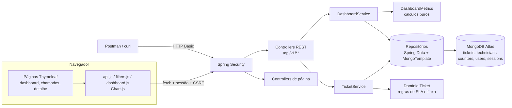

Pacotes em `src/main/java/br/com/danielcardoso/thindesk`:

| Pacote | Responsabilidade |
|---|---|
| `ticket.domain` | `Ticket`, `Technician`, enums (`TicketStatus`, `TicketPriority`, `TicketType`, `Department`) e as regras do fluxo de situações e do SLA |
| `ticket.repository` | Repositórios Spring Data e `TicketQueryRepositoryImpl` (filtros dinâmicos com `Criteria`, paginação, contador de protocolo) |
| `ticket.service` / `ticket.dto` | Casos de uso dos chamados, filtros normalizados, corpos de requisição e resposta |
| `dashboard` | `DashboardService` (orquestra) e `DashboardMetrics` (cálculo dos indicadores, série histórica, rankings) |
| `api` | Controllers REST e tratamento padronizado de erros |
| `web` | Controllers das páginas do painel |
| `bootstrap` | Criação do administrador inicial e da massa de demonstração |
| `config`, `security`, `user`, `admin`, `theme` | Base reaproveitada da atividade de login, adaptada (API, entrada JSON 401/403, CSP do Swagger) |

### 4.3 Modelo de dados

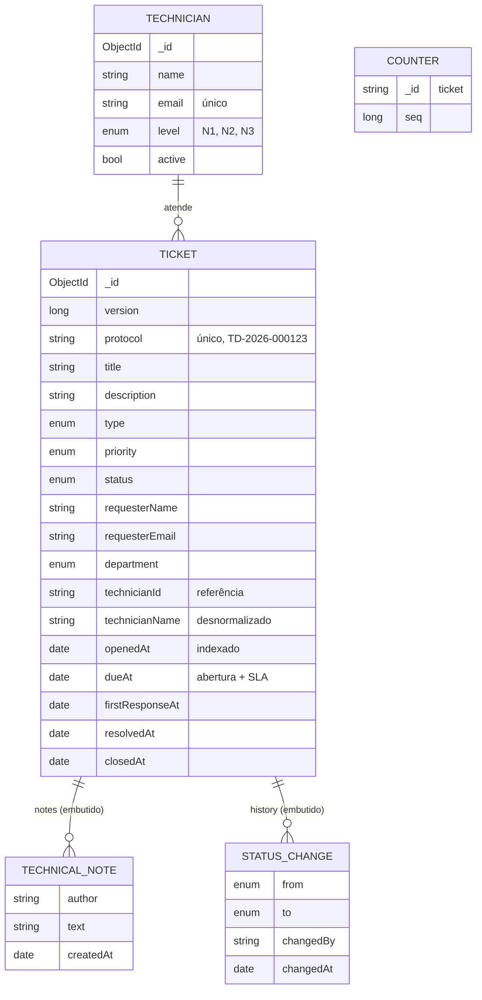

Exemplo de documento da coleção `tickets`:

```json
{
  "_id": "6af1d146982ced63ebadb715",
  "version": 4,
  "protocol": "TD-2026-001233",
  "title": "Teclado com teclas falhando",
  "description": "Algumas teclas do teclado não respondem.",
  "type": "HARDWARE",
  "priority": "LOW",
  "status": "IN_PROGRESS",
  "requesterName": "João Pedro Santos",
  "requesterEmail": "joao.santos@exemplo.com.br",
  "department": "SALES",
  "technicianId": "6af1d145982ced63ebadb240",
  "technicianName": "Rafael Oliveira",
  "openedAt": "2026-10-19T11:20:00Z",
  "dueAt": "2026-10-22T11:20:00Z",
  "firstResponseAt": "2026-10-19T14:02:00Z",
  "notes": [
    { "author": "Rafael Oliveira", "text": "Acesso remoto realizado. Verificando configurações da estação.", "createdAt": "2026-10-19T14:02:00Z" }
  ],
  "history": [
    { "from": "OPEN", "to": "IN_PROGRESS", "changedBy": "Rafael Oliveira", "changedAt": "2026-10-19T14:02:00Z" }
  ]
}
```

### 4.4 Regras de negócio

- **SLA por prioridade:** Baixa 72 h, Média 24 h, Alta 8 h, Crítica 4 h. O prazo (`dueAt`) é calculado na abertura.
- **Fluxo de situações:** Aberto > Em atendimento > (Aguardando usuário) > Resolvido > Fechado, com cancelamento a partir de Aberto, Em atendimento ou Aguardando, e reabertura de Resolvido para Em atendimento. Fechado e Cancelado são finais (diagrama em [API.md](API.md#patch-ticketsidstatus)).
- Iniciar o atendimento exige técnico atribuído; resolver exige registrar a solução; cancelar exige o motivo.
- Chamados finalizados não aceitam notas, transferência nem nova situação. Técnico inativo não recebe chamados.
- Datas dos indicadores são gravadas pelo domínio: 1ª resposta no primeiro "Em atendimento", solução ao resolver (limpa na reabertura), encerramento ao fechar ou cancelar.

### 4.5 Principais decisões de projeto

| Decisão | Justificativa |
|---|---|
| Reaproveitar a base da atividade de login | Ela foi construída para ser reutilizada: o painel herdou autenticação, perfis, sessões no Atlas, layout e temas sem reescrever nada disso. O responsável pelos chamados é o perfil `MANAGER` |
| MongoDB com notas e histórico **embutidos** no chamado | Notas e histórico só existem dentro do chamado e são sempre lidos junto com ele: um documento por chamado evita junções e mantém a gravação atômica |
| Nome do técnico **desnormalizado** no chamado | Os rankings e listas não precisam consultar a coleção de técnicos; o id continua sendo a referência |
| Filtros no banco, cálculos em Java (`DashboardMetrics`) | O MongoDB aplica os filtros com índices e devolve só os campos necessários; os cálculos ficam em funções puras, testadas com cenários montados à mão (13 testes com resultados calculados manualmente). Para o volume de um help desk (milhares de chamados) isso é rápido; com milhões, os mesmos cálculos migrariam para `$group` no aggregation pipeline sem mudar o contrato da API |
| Um endpoint por bloco do dashboard | Cada bloco carrega e falha de forma independente (um erro não derruba o painel), os endpoints ficam reutilizáveis por outros clientes e a documentação mapeia 1:1 com os requisitos |
| Mesmos filtros em todos os endpoints | Um único objeto de filtros (`TicketSearchParams`) garante que todos os números do painel se refiram ao mesmo recorte |
| Série histórica conta "abertos" pela abertura e "atendidos" pela data de solução | Responde corretamente "quanto foi atendido no período", inclusive chamados abertos antes do período e resolvidos dentro dele |
| `null` em médias sem dados | Evita mostrar "0 h" ou "0%" quando, na verdade, não há base de cálculo |
| Páginas Thymeleaf + dados via `fetch` | Mesma stack da M1 e integração com a API explícita (RF06): o painel usa exatamente a API documentada |
| Sessão + HTTP Basic na API | O painel usa a sessão (com CSRF); Postman e integrações usam Basic. 401/403 da API saem em JSON e sem `WWW-Authenticate` |
| Problem Details (RFC 9457) | Padrão oficial do HTTP, suportado nativamente pelo Spring, com um `code` estável para o front tratar cada caso |
| 422 para regra de negócio, 400 para validação | Separa "a requisição está mal formada" de "a requisição é válida, mas o estado do chamado não permite" |
| Atualização automática por *polling* de 60 s | Simples e suficiente para um painel gerencial; pausa com a aba oculta para não gerar carga à toa |
| Relógio injetável (`Clock`) e fuso configurável | Testes de SLA e de série histórica com data fixa; agrupamento por dia no fuso de São Paulo, não em UTC |
| Massa de demonstração determinística | 1.400 chamados em 180 dias com semente fixa, gerados pelas próprias regras de domínio (mais volume em dias úteis, backlog recente e chamados fora do SLA), para o painel ter dados realistas |

## 5. Documentação dos endpoints

A documentação completa, com parâmetros, exemplos de requisição e resposta e possíveis erros de cada endpoint, está em **[docs/API.md](API.md)**. A documentação interativa (OpenAPI 3) fica em [http://localhost:8080/swagger-ui.html](http://localhost:8080/swagger-ui.html).

| Método | Endpoint | RF |
|---|---|---|
| GET | `/api/v1/dashboard/summary` | RF01 |
| GET | `/api/v1/dashboard/timeline` | RF02 |
| GET | `/api/v1/dashboard/status` | RF03 |
| GET | `/api/v1/dashboard/types` | RF04 |
| GET | `/api/v1/dashboard/technicians` | RF01/RF04 |
| GET | `/api/v1/dashboard/filters` | RF05 |
| GET | `/api/v1/tickets` | RF03/RF05 |
| GET | `/api/v1/tickets/{id}` | RF03 |
| POST | `/api/v1/tickets` | RF07 |
| PATCH | `/api/v1/tickets/{id}/status` | RF07 |
| PATCH | `/api/v1/tickets/{id}/assignment` | RF07 |
| POST | `/api/v1/tickets/{id}/notes` | RF07 |
| GET | `/api/v1/technicians` | RF05 |

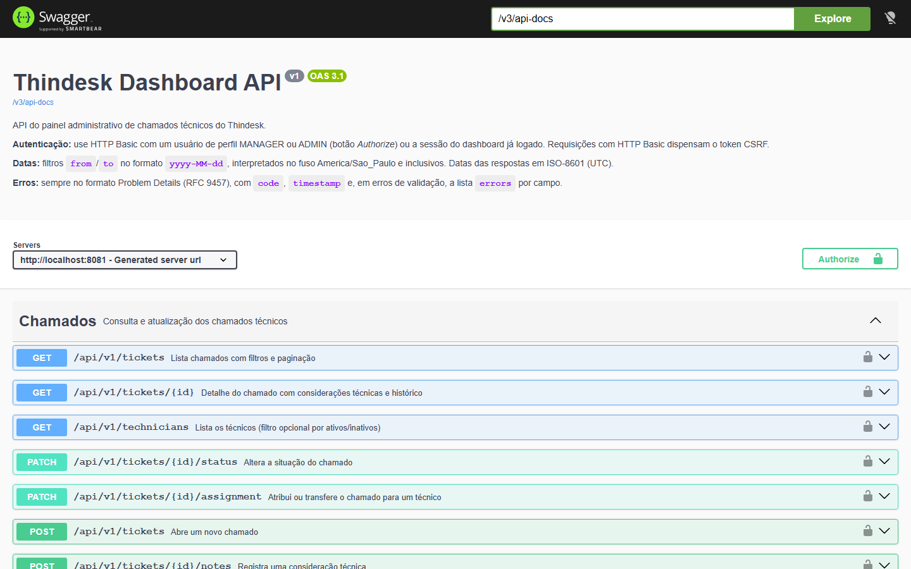

## 6. Dashboard funcional

**Visão completa do dashboard (últimos 30 dias):**

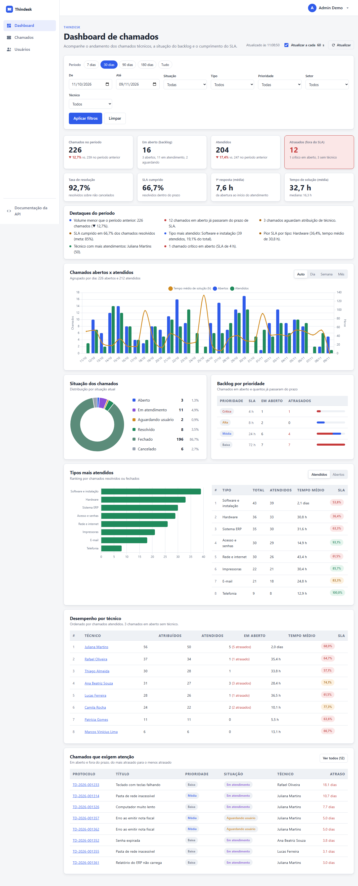

**RF01: indicadores gerais e destaques.** Comparação com o período anterior, alerta visual quando há chamados atrasados e destaques gerados a partir dos dados.

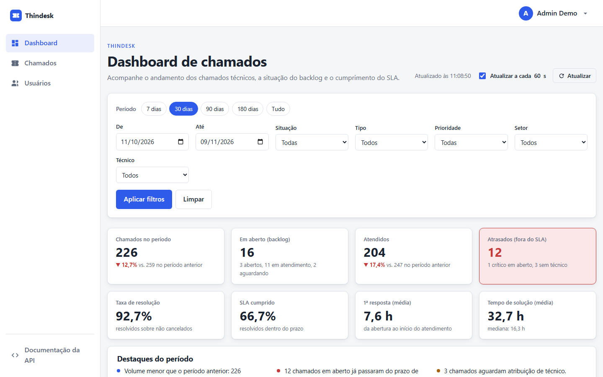

**RF02 + RF05: série histórica com filtros aplicados** (90 dias, apenas Hardware, agrupado por semana automaticamente).

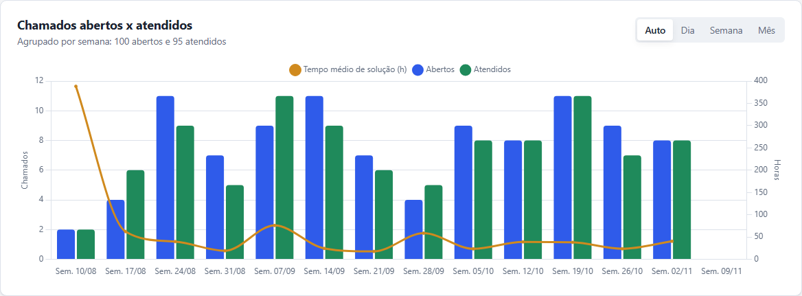

**RF03: situação dos chamados e backlog por prioridade.** Cada item da legenda abre a lista de chamados já filtrada por aquela situação.

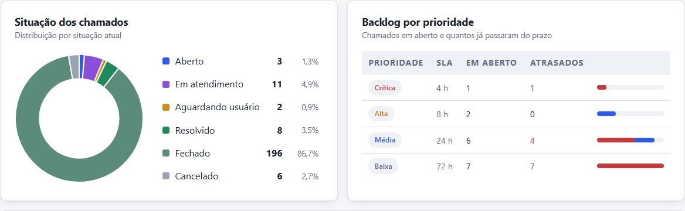

**RF04: tipos mais atendidos** (com SLA por tipo) e desempenho por técnico.

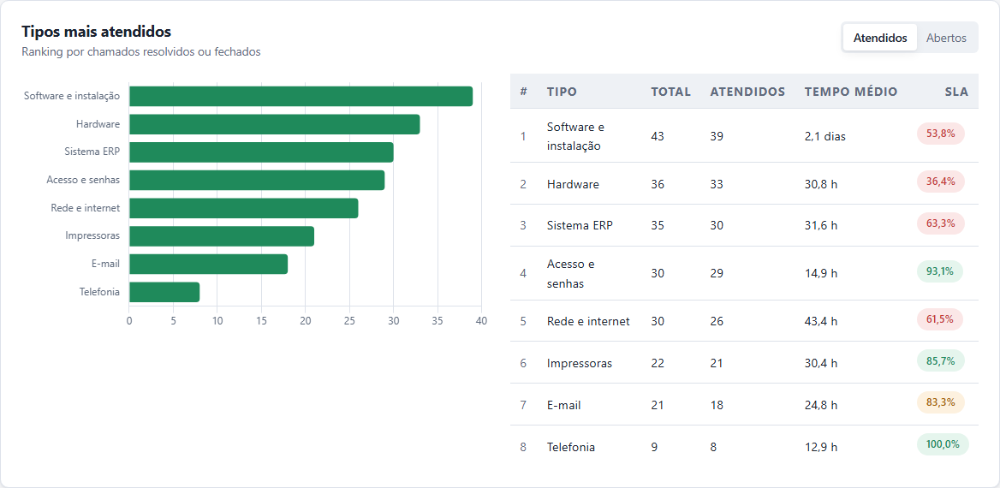

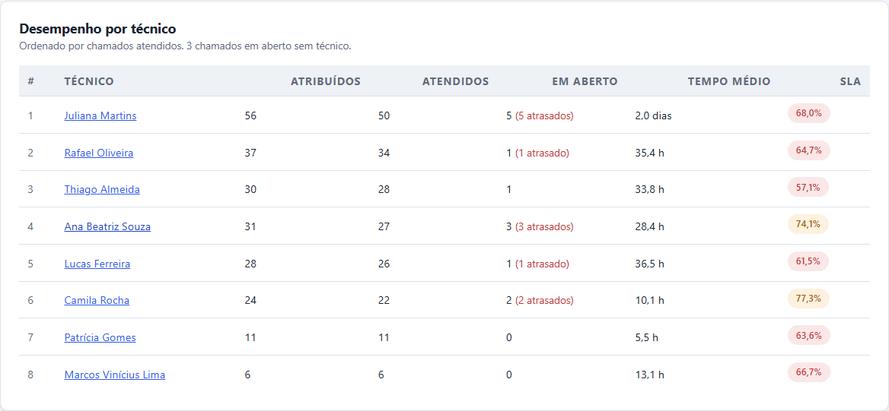

**Lista de chamados** com filtros, busca, ordenação, paginação e abertura de chamado.

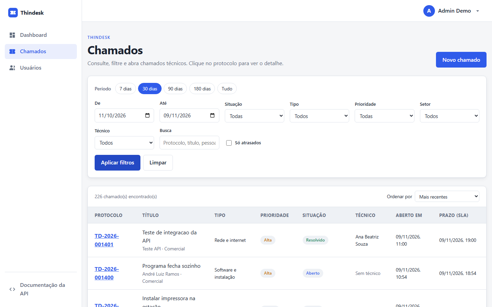

**Detalhe do chamado (RF03 e RF07):** considerações técnicas, histórico, SLA e ações (situação, técnico, nova consideração).

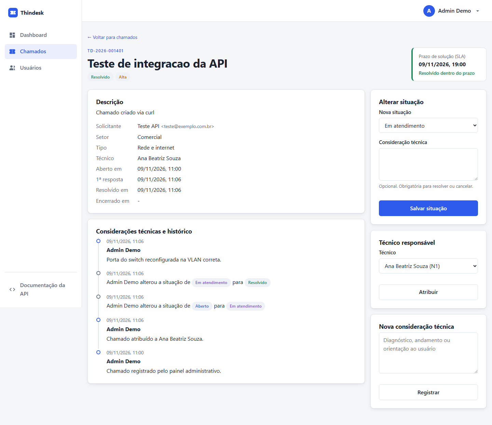

**Responsividade** (390 px de largura):

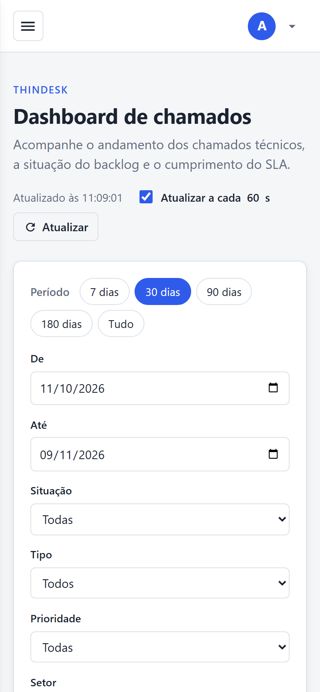

## 7. Evidências de testes

### 7.1 Testes automatizados (JUnit 5): 75 de 75 aprovados

Executados com `./mvnw test`. Não dependem do Atlas. Lista completa: [evidencias/testes-automatizados.md](evidencias/testes-automatizados.md).

| Classe | Testes | O que cobre |
|---|---|---|
| `DashboardMetricsTest` | 13 | Cenário com 7 chamados e resultados calculados à mão: totais, taxa de resolução, SLA, médias e mediana, série diária e semanal com dias zerados, fuso de São Paulo, granularidade automática e limite de pontos, situação com prioridades, rankings de tipos e técnicos, ausência de dados (`null`) |
| `TicketWorkflowTest` | 8 | Prazo de SLA, fluxo de situações, técnico obrigatório, datas de 1ª resposta/solução/fechamento, reabertura, atraso, técnico inativo, chamados finalizados |
| `TicketServiceTest` | 5 | Protocolo sequencial e normalização, solução obrigatória, nota de transferência, erros de técnico e chamado inexistentes |
| `DashboardApiTest` | 18 | Camada web da API com Spring Security real: 401 JSON sem `WWW-Authenticate`, 403 por perfil, HTTP Basic, validação de período, enums, datas, `limit`, `sort` e `size`, 404, 422, CSRF obrigatório com sessão e dispensado com Basic, 201 com `Location`, erros por campo, JSON malformado, 404/405 em rota inexistente, página do dashboard |
| `AccessControlTest`, `UserServiceTest`, `LoginAttemptServiceTest`, `PasswordValidationTest` | 31 | Base de login reaproveitada (perfis, telas iniciais, CSRF, cabeçalhos de segurança, BCrypt, bloqueio por tentativas, política de senha) |

```text
[INFO] Tests run: 75, Failures: 0, Errors: 0, Skipped: 0
[INFO] BUILD SUCCESS
```

### 7.2 Testes de integração da API (banco real): 40 de 40 aprovados

O script [`scripts/testes_api.py`](../scripts/testes_api.py) roda contra a aplicação ligada ao MongoDB Atlas: consulta todos os endpoints, testa os casos de erro documentados e leva um chamado de teste de "Aberto" até "Fechado". Relatório completo: [evidencias/testes-api-integracao.md](evidencias/testes-api-integracao.md).

```bash
python scripts/testes_api.py http://localhost:8080 <email> <senha> docs/evidencias/testes-api-integracao.md
```

Respostas reais de cada endpoint salvas em [`docs/evidencias`](evidencias/).

### 7.3 Testes manuais pela interface

| # | Verificação | Resultado |
|---|---|---|
| 1 | Login com perfil ADMIN abre o dashboard; visitante em `/dashboard` vai para `/login` | OK |
| 2 | Todos os blocos carregam sem erros no console do navegador | OK |
| 3 | Atalhos de período, filtros combinados e "Limpar" atualizam todos os blocos e a URL | OK |
| 4 | Data inicial maior que a final mostra erro no formulário e não consulta a API | OK |
| 5 | Botões Dia/Semana/Mês e Atendidos/Abertos mudam o agrupamento do gráfico e a ordem do ranking | OK |
| 6 | Atualização automática altera o horário "Atualizado às" | OK |
| 7 | Legenda da situação e nome do técnico abrem a lista já filtrada | OK |
| 8 | Lista: busca, "só atrasados", ordenação e paginação | OK |
| 9 | Novo chamado com campos vazios mostra a mensagem de cada campo vinda da API | OK |
| 10 | Detalhe: atribuir técnico, iniciar, tentar resolver sem solução (mensagem da regra), resolver com solução; SLA e histórico atualizados | OK |
| 11 | Layout em 390 px sem rolagem horizontal | OK |
| 12 | Swagger UI lista os 12 caminhos da API e executa chamadas com "Authorize" (Basic) | OK |

## 8. Como executar

Pré-requisitos: JDK 21 e uma conta no MongoDB Atlas (passo a passo do Atlas no [README](../README.md#configurando-o-mongodb-atlas)).

```bash
cp .env.example .env      # preencha MONGODB_URI, ADMIN_EMAIL e ADMIN_PASSWORD
./mvnw spring-boot:run    # Windows: mvnw.cmd spring-boot:run
```

Na primeira execução o sistema cria o administrador e a massa de demonstração (9 técnicos e 1.400 chamados nos últimos 180 dias). Acesse [http://localhost:8080](http://localhost:8080).

## 9. Fluxo de branches (Gitflow)

| Branch | Conteúdo |
|---|---|
| `main` | Versões estáveis, marcadas com tag (`v1.0.0`) |
| `develop` | Integração do desenvolvimento |
| `feature/base-login` | Base reaproveitada da atividade de login, renomeada para Thindesk |
| `feature/ticket-domain` | Domínio de chamados, regras de SLA e fluxo, repositórios e massa de demonstração |
| `feature/dashboard-api` | Endpoints REST, filtros, cálculos dos indicadores, erros padronizados, segurança da API e OpenAPI |
| `feature/dashboard-ui` | Telas do dashboard, lista e detalhe de chamados com Chart.js |
| `feature/tests` | Testes automatizados e roteiro de integração |
| `feature/docs` | README, documentação, evidências e coleção Postman |
| `release/1.0.0` | Preparação da versão, mesclada em `main` e `develop` |

## 10. Roteiro da apresentação (vídeo de até 3 minutos)

| Tempo | Cena | Fala (resumo) |
|---|---|---|
| 0:00 a 0:20 | Tela de login, entrar como gestor | Problema: o responsável pelos chamados precisa acompanhar a operação. Solução: dashboard do Thindesk alimentado por uma API própria, Spring Boot + MongoDB Atlas, mesma stack da atividade de login, cuja base foi reaproveitada |
| 0:20 a 0:55 | Dashboard: cards, destaques, gráfico | RF01: indicadores com comparação ao período anterior. Destaques apontam atrasos, tipo com pior SLA e técnico com maior fila. RF02: abertos x atendidos; trocar Dia/Semana/Mês |
| 0:55 a 1:20 | Aplicar filtros (90 dias, Hardware) | RF05: os mesmos filtros valem para todos os blocos e ficam na URL. RF03: situação e backlog por prioridade; RF04: tipos mais atendidos e técnicos |
| 1:20 a 1:50 | Abrir um chamado atrasado, atribuir, tentar resolver sem solução, resolver | RF07: atualização pela API com regras de negócio (422 com mensagem clara), considerações técnicas e histórico; voltar ao dashboard e clicar em "Atualizar" |
| 1:50 a 2:25 | Swagger e Postman (um 200 e um 400) | RF06: API REST versionada, 13 endpoints, um por bloco do painel, erros em Problem Details com `code` e lista de campos, HTTP Basic para integrações |
| 2:25 a 2:50 | `./mvnw test` e o relatório de integração | 75 testes automatizados e 40 casos de integração contra o banco real |
| 2:50 a 3:00 | GitHub com as branches | Gitflow com uma branch por funcionalidade e release 1.0.0 |

Decisões para citar na fala: notas embutidas no documento do chamado (MongoDB), cálculos em funções puras testáveis, um endpoint por bloco para falhas isoladas, 400 x 422, *polling* de 60 s.

## 11. Limitações e próximos passos

- Os cálculos são feitos na aplicação; para volumes muito grandes, migrar para `$group` do aggregation pipeline do MongoDB, mantendo os mesmos endpoints.
- Atualização por *polling*; uma evolução natural é enviar eventos por Server-Sent Events quando um chamado mudar.
- Exportação dos dados filtrados (CSV/PDF) e metas de SLA configuráveis por tipo de chamado.
- O bloqueio por tentativas de senha vale para o login do formulário; para o HTTP Basic da API, a conta bloqueada também é recusada, mas as tentativas não são contadas.
